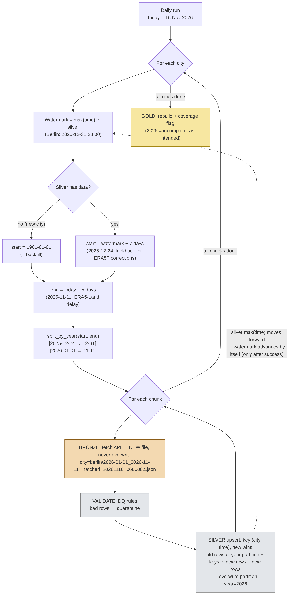
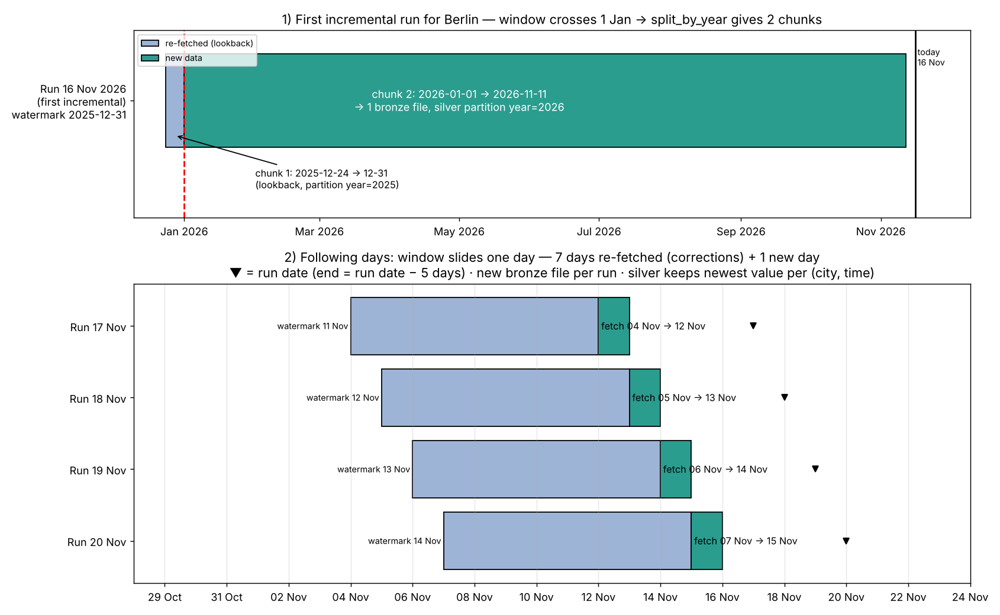

# ADR-002: Incremental loading and bronze file naming

## Status
Accepted — 2026-11-15

## Context
- Backfill 1961–2025 is done for the 23 European cities: one bronze JSON per city × full year, named `city=<slug>/<YYYY>-01-01.json`.
- From 2026 on, data must be loaded incrementally (capstone requirement: new data, updated records, no duplicates, recover partway, watermark).
- ERA5-Land arrives about 5 days late; recent values (ERA5T) can still be corrected afterwards.
- The pipeline moves to Azure Databricks in week 3 (Auto Loader reads new files from a landing folder and remembers processed files by path; it does not re-read a file that was overwritten under the same name by default — to verify in the docs).
- Problem found in design review: the year-based file name cannot hold a partial window and would be overwritten on re-runs.

## Decision
1. **One bronze naming pattern for all files** (backfill and incremental):
   `data/bronze/city=<slug>/<start>_<end>__fetched_<YYYYMMDDTHHMMSSZ>.json` (dates inclusive, fetch time in UTC).
2. **Bronze is immutable / append-only:** every fetch creates a new file; files are never overwritten or edited.
3. **Existing files are renamed once** to the new pattern; `fetched_` = the file's modification time in UTC (best available approximation of the download time).
4. **Watermark** = `max(time)` per city, read from silver. No separate state file.
5. **Fetch window** = `watermark − 7 days` (lookback for ERA5T corrections) to `today − 5 days` (ERA5-Land delay). `today` is a function parameter (testable).
6. **`split_by_year`:** a window crossing 1 January is split so that every fetch / bronze file / silver write touches exactly one year partition.
7. **Deduplication:** key `(city, time)`, newest data wins.
   - Now (local, Parquet): read the whole existing year partition → left-anti join with the new rows → union → overwrite that partition (dynamic partition overwrite).
   - Week 3 (Delta on Databricks): `MERGE` on `(city, time)`.
8. **Watermark advances only after a successful silver write** — automatic, because the watermark is computed from silver.
9. When several bronze files cover the same window, transform uses the one with the newest `fetched_` timestamp.

## Alternatives considered
- Keep `<YYYY>-01-01.json` and add a second pattern only for incremental files — rejected: two patterns, two parsers; re-runs of the same window still overwrite.
- Watermark in a state file (`state/watermarks.json`) — rejected for now: does not heal when silver is partly deleted; can drift from the data.
- Advance the watermark before writing silver — rejected: a crash after a fetch longer than 7 days leaves a permanent, silent gap.
- Keep the older row on duplicates — rejected: corrected ERA5T values would be lost.
- Window function (`row_number` over `(city, time)` by `processed_at`) for dedup — possible; anti-join chosen because it does not depend on timestamps (no ties).

## Scenarios checked (design review)
| # | Scenario | Result |
|---|---|---|
| 1 | Backfill (first run, new city) | full-year windows; watermark `None` → start 1961-01-01, split into years |
| 2 | Daily incremental | new window → new file → anti-join into the year partition |
| 3 | Re-run after failure | new `fetched_` name, no overwrite; dedup by `(city, time)` → same silver (idempotent) |
| 4 | Boundaries | year change handled by `split_by_year`; leap years via date arithmetic; times are UTC (no DST issue) |
| 5 | Scale / Databricks | ~67 small files per day (23 + 44 cities); Auto Loader sees each file once |

## How it works — walk-through (Berlin)

**Backfill vs incremental**
| | Backfill (done, 1961–2025) | Incremental (from 2026) |
|---|---|---|
| Loop | city × year | city only |
| `start`, `end` | fixed: `YYYY-01-01`, `YYYY-12-31` | computed from the watermark and today |

**Daily steps per city**
1. Watermark = `max(time)` in silver (Berlin after backfill: 2025-12-31 23:00). No data yet → start = 1961-01-01 (a new city is simply a backfill).
2. `start` = watermark − 7 days; `end` = today − 5 days.
3. `split_by_year(start, end)` → chunks that each stay inside one year.
4. Per chunk: fetch → new bronze file (`<start>_<end>__fetched_<UTC>.json`) → validate (bad rows → quarantine) → upsert into the silver year partition (key `(city, time)`, new wins).
5. After all cities: rebuild gold (coverage flags the running year as incomplete).
6. The watermark moves forward by itself, because it is read from silver — only after a successful write.

**Example dates**
| Run | Watermark | Fetch window | Chunks |
|---|---|---|---|
| 16 Nov 2026 (first) | 2025-12-31 | 2025-12-24 → 2026-11-11 | [2025-12-24 → 12-31] (lookback, partition 2025) · [2026-01-01 → 11-11] |
| 17 Nov 2026 | 2026-11-11 | 2026-11-04 → 11-12 | 1 |
| 18 Nov 2026 | 2026-11-12 | 2026-11-05 → 11-13 | 1 |

Each day the window slides by one day: 7 days are re-fetched (ERA5T corrections), 1 day is new.

**Reading bronze:** `start`/`end` say *which window*, `fetched_` says *which version*. `latest_bronze_path(city, start, end)` returns the newest file for exactly that window (re-runs of the same window). Overlapping windows with different ends are reconciled in silver, not in bronze.
Backlog: *replay* — rebuild silver from all bronze files of a year, ordered by `fetched_`.

## Gaps covered elsewhere
- Gap at the end of the data → watermark (this ADR).
- Whole city-year missing in silver → `silver_exists(city, year)` in the pipeline.
- Hours missing inside a year → `coverage` / `incomplete` in gold.

## Consequences
- (+) Same design works locally and on Databricks; every fetch is traceable; corrections can be compared between fetches.
- (+) "Recover partway" comes for free: a failed run is simply repeated.
- (–) More files in bronze; transform must pick the newest file per window.
- (–) One-off rename of all existing bronze files; ingest's "already loaded?" check changes from one exact path to a glob `<start>_<end>__fetched_*.json`.
- (–) `fetched_` of renamed files is approximate (file modification time).
- The current year (2026) will be flagged `incomplete` in gold until the year is over — intended.

## Implementation order
1. ✅ Stop all running ingests; commit.
2. ✅ Rename script (`scripts/rename_bronze.py`): dry run, review, rename (2,410 files, 2026-11-15/16; skips files already renamed → safe to rerun).
3. 🟡 Code: `new_bronze_path(city, start, end, fetched_at)` for writing, `latest_bronze_path(city, start, end)` (glob, newest) for reading; ingest existence check; validate reads the newest file; tests updated.
4. Check: rerun the European pipeline → must skip all 1,495 files (no download).
5. Then: `fetch_window`, `split_by_year` (+ tests), `upsert_silver` (anti-join), incremental run mode.
