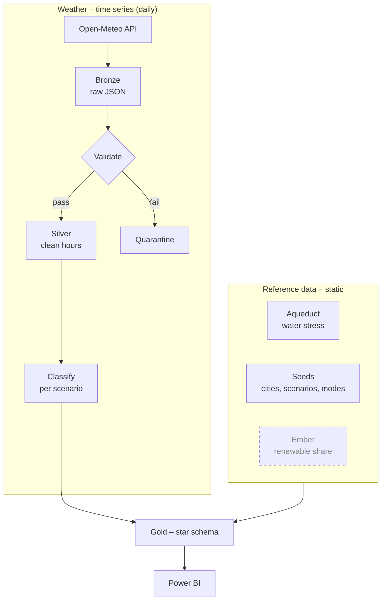

# CoolSite – architecture

How data flows from the sources to the dashboard. Table details (grain, keys, columns): see `data_model.md`.

Dashed = planned. The pipeline runs locally with PySpark now and moves to Azure Databricks (planned); Power BI Desktop runs on an Azure Windows VM.

- **Weather (time series):** backfill 1961–2025, then a daily incremental load up to today − 7 days. Watermark = latest hour per city in silver.
- **Water stress (static reference):** downloaded once; a one-off script joins each city point to its river basin (spatial join) → `dim_city`.
- **Seeds (in Git):** city list, cooling scenarios (parameters), cooling modes.
