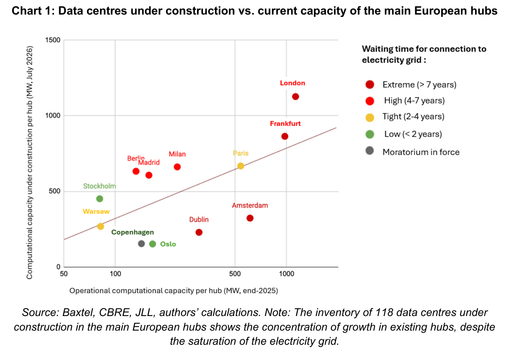
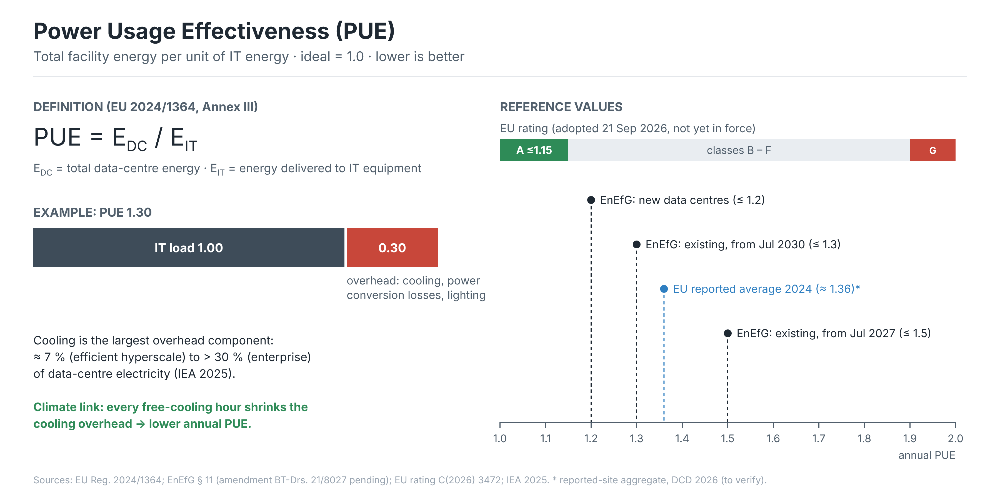
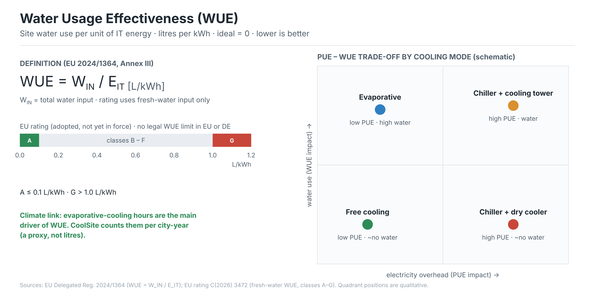

# CoolSite – details behind capstone_idea.md

Long version: full research notes, the dated decision log, open items and all sources. The short overview is `capstone_idea.md` (same structure as `CoolSite_capstone_idea.pdf`).

Last updated: 2026-11-13

## A. Research notes: why siting is changing

Storyline: **power → AI flexibility → regulation → cooling**. CoolSite measures only the last step (climate → cooling). The first three explain why that step matters now.

### 1. Grid power is the bottleneck in the FLAP-D hubs
- FLAP-D (Frankfurt, London, Amsterdam, Paris, Dublin) holds about **three quarters of Europe's installed compute** and still attracts most new construction (Banque de France 2026, Chart 1).
- Waiting time for a grid connection is **up to 10 years in Frankfurt and London**; data centres in Dublin use **20 % of Ireland's electricity** (BdF 2026).
- Chart 1 (BdF): x = capacity running end-2025 (MW, **log scale**), y = capacity under construction July 2026 (MW), colour = grid waiting time. Berlin builds ≈ 5× its current size despite a 4–7-year wait; Stockholm/Oslo have < 2 years.

*Source: Banque de France, Eco Notepad 470 (Nasr & Toulouse, 4 Nov 2026), Chart 1; data: Baxtel, CBRE, JLL, authors' calculations.*

- The shift to new regions is slow: secondary hubs get only **~30 % of the growth forecast for 2026**; Microsoft's 1.2 GW Sines (Portugal) campus has 36 MW running and 180 MW under construction (BdF 2026).

### 2. AI training can move — so cheap power and climate weigh more
- McKinsey projection for 2030 (cited in BdF 2026): **28 % of data-centre electricity for AI training, 43 % inference, 29 % non-AI**. Training does not need to be near users; BdF estimates **~54 % of demand could be relocated**.
- Electricity is **up to 60 % of operating costs** of AI data centres (BdF 2026) → electricity price and cooling overhead become siting factors, latency less so.
- Limits: inference, "sovereign cloud" and near-zero-latency sectors (finance, healthcare, some industry) stay tied to locations.

### 3. Regulation puts a number on efficiency (see private/research/EU and German data centre rules.md — private notes, not in the repo)
- **Germany (EnEfG, in force): hard PUE caps** — new data centres ≤ 1.2, existing ≤ 1.5 from 2027 and ≤ 1.3 from 2030, plus waste-heat reuse and renewables duties. Bill BT-Drs. 21/8027 would loosen parts of this — **not passed** (check status before the final presentation).
- **EU: reporting, not limits.** Sites ≥ 500 kW report PUE and WUE yearly (Reg. 2024/1364); per-site data stays confidential.
- **WUE is graded, not capped:** the EU A–G rating (adopted 21 Sep 2026, **not yet in force**) grades PUE and WUE separately and does **not adjust for climate**. No EU or German law sets a WUE limit.
- → A site in a hot climate starts with a handicap on PUE (chillers) or WUE (evaporative water), and the label does not correct for it.

- The two efficiency numbers the rules use:

## B. Decision log

Last reviewed 2026-11-10. Grouped by topic; the newest decision wins, superseded items are marked.

### Scope and user
- Path A (domain-driven).
- User: a company deciding where to build a data centre (one user only; ops team / live alerts = optional stretch goal).
- Cities (2026-10-19, supersedes the earlier "10 challengers"): 5 FLAP-D (baseline) + 18 challengers (see candidate_cities.md) = 23 cities. Develop with 3 first (Frankfurt + 1 cold + 1 hot), scale via `data/seed/cities.csv`. Open: one inclusion rule instead of 23 individual reasons.
- Non-EU cities allowed for climate comparison; every city gets a `regulatory_zone` flag (EU / EEA / non-EU). London (baseline) is non-EU.
- Reference city: Frankfurt (German EnEfG applies there).

### Core: cooling-mode classification
- (2026-10-31) Cooling-mode classification is the CORE of the project. Key dashboard question: "Does this city's climate push a data centre towards high electricity use (chiller → worse PUE), high water use (evaporative → WUE pressure), or neither (free cooling → good PUE and WUE)?" Every valid hour gets exactly one mode. 'Water hours' (evaporative) = proxy for water use, NOT litres. Assumption: the chiller uses a dry cooler (no water); with cooling towers it also uses water.
- (2026-11-10, corrected the same day after testing on real Frankfurt data) The classification depends on a `design` parameter:
  - **direct** (MVP), per hour in this order: (0) dew point > 15 °C → **chiller** + flag `humidity_limited` (applies to ALL hours — the first version checked only cool hours and sent a 28 °C hour with dew point 19 °C to evaporative while a 25 °C hour with the same dew point went to chiller); (1) T < A → **free cooling**; (2) wet-bulb ≤ B → **evaporative**; (3) else **chiller**. Separate column that never changes the mode: `too_dry` = dew point < −9 °C (humidifying costs water; reported as its own count, not as water hours).
  - **indirect** (scenario after the MVP): no dew-point checks, no flags; stricter thresholds because of the heat exchanger: A_ind = T_return − (T_return − A) / ε_HX, B lowered the same way.
  - In code: the dew-point condition is added to the `F.when` chain only if `design == "direct"` (Python `if`, not a Spark condition).
- (2026-11-10) **Everything is a parameter** in the config, nothing hard-coded. Starting values from **ASHRAE TC 9.9 (2016), recommended range** (Table 2, p. 11–12): inlet 18–27 °C, dew point −9 … 15 °C, RH ≤ 60 % (allowable values: to verify). Not from ASHRAE: B (no source yet), ε_HX (example 0.7, used by Park & Seo 2018 — test other values), T_return (example 37 °C, to source), evaporative effectiveness (example 0.8, to source). Open: B as a fixed wet-bulb threshold or via the formula T − ε_evap · (T − wet-bulb) ≤ target — use the same method in both designs.
- Wet-bulb: take the Open-Meteo value AND compute our own (Stull 2011) → unit test comparing both.
- First test (Frankfurt 1 Jun – 1 Sep 2026, 2,232 h, illustrative parameters A = 27 °C, ε_HX = 0.7, T_return = 37 °C): direct free 61 % / evap 15 % / chiller 24 % (all humidity-limited); indirect free 59 % / evap 33 % / chiller 8 %.

### Metrics (gold)
- (2026-11-09/10) Per city × year (× design once indirect runs): hours and **shares of valid hours** per mode, coverage (valid ÷ expected hours), counts of `humidity_limited` and `too_dry` hours. A city-year is used in comparisons only if ≥ 99.9 % of its hours are valid, otherwise it is marked `incomplete`. Check: free + evaporative + chiller = valid hours.
- Supersedes the early metric list (2026-10): "free-cooling hours (dry-bulb only)" and "hours above a wet-bulb threshold" are now covered by the mode shares. Still a candidate: heating degree days → waste-heat reuse (ERF), see open item 2b.

### Data and data quality
- Main source: Open-Meteo Historical Weather API (ERA5, hourly since 1940, ~5-day delay); backfill from 1961-01-01.
- Updates: every run reloads the last ~7 days and overwrites them (idempotent; also the backfill mechanism). A live speed layer is deferred.
- (2026-11-05 → 2026-11-10) Data quality per **data_contract.md v0.4**: DQ-01 fields, DQ-02 timezone = structural gate (run stops); DQ-03 time range, DQ-04 duplicates, DQ-05 gaps = dataset checks; DQ-06..09 = row rules → quarantine with rule IDs. Severity: ≤ 2 unusable hours per file → warning, more → error; city-year ≥ 99.9 % valid. Each check returns a severity-message pair or None; validate() reports warnings and raises once for errors.
- (2026-11-13) Time is stored in **UTC** in bronze and silver (one time zone for all cities, no daylight-saving issues). Local time is used only for hour-of-day views (e.g. the hour × month heatmap), converted with `F.from_utc_timestamp`; the time zone per city comes from a `timezone` column in `cities.csv` (e.g. Europe/Berlin).

- (2026-11-14) **Cities reference table**: `data/seed/city_list.csv` is maintained by hand (city slug, name, country; later group, region (UN M49 subregion, e.g. western_europe), regulatory_zone, active, tier, reason). `src/build_cities.py` generates `data/seed/cities.csv` from it: lat/lon/timezone/country_name from the Open-Meteo Geocoding API (based on GeoNames — attribution required) and the Köppen class + description. `cities.csv` is generated, never edited by hand. One file for all cities; `tier` (project / extended) + `active` decide what gets loaded — no separate world list, no large background harvesting during the capstone.
- (2026-11-14) **Climate zone**: Köppen-Geiger class from Beck et al. (2023), Scientific Data, doi 10.1038/s41597-023-02549-6, period 1991–2020 only (current WMO reference period), 0.1° map to match the ERA5-Land grid. Raster files in `data/reference/` (not in Git). Climate change is shown with own data (free-cooling hours 1961–2026), not with Köppen shifts.
- (2026-11-14) **DQ-09 tolerance 0.1 °C** (contract v0.6): first real quarantine (Stockholm 2024, dew point 0.1 °C above temperature at RH 100 %) was API rounding, not bad data. Chose a documented tolerance instead of repairing values; values in silver stay as delivered.
- (2026-11-14) **API budget**: weighted calls = days/14 × variables/10 per location (confirmed with the calculator on open-meteo.com/en/pricing). 3 variables × 1 year ≈ 7.8 calls; 23 cities × 1961–2026 ≈ 12,000 calls ≈ 2 days at 10,000/day → ingest must be resumable (skip existing files) with a daily budget. Bulk ERA5-Land (Copernicus CDS) only as the scaling path (hundreds of locations / gridded maps), not for 23 points.

### Engine and platform
- (2026-11-04) Build **locally first** (thin slice → full local pipeline = guaranteed, gradable fallback), then **migrate to Databricks** (target Azure Databricks; plan B Databricks Free Edition). Decision rule: if the move is not working by mid capstone week 3, present the local pipeline + deployed thin slice + migration plan. Portability rules: pure logic separate from IO; all paths/settings in config (local.yaml vs azure.yaml); Delta format from day one if possible; transforms in Spark SQL/PySpark; secrets only via env vars. Databricks learning: 4 sessions on Free Edition before capstone start.
- (2026-11-05) Local engine = **PySpark + Spark SQL** (same engine as Databricks → no rewrite). This resolves the open "option A vs B" from 2026-11-04.
- Storage: the ADR-001 draft (Parquet on S3; DynamoDB and RDS rejected) is **superseded** by the 2026-11-04 platform decision → ADR-001 must be rewritten for Delta locally / Azure Databricks.

### Extras and future scenarios
- Climate is the core; at most 2 extra layers. Candidates: hand-maintained capacity seed CSV (MW per city, source + report date, SCD2), grid waiting time (e.g. from BdF Chart 1), water stress (WUE), one hazard layer, grid renewable share (REF), station data cross-check (Meteostat/ECA&D).
- Extra #1 (2026-10-20): climate projections to 2050 via the Open-Meteo Climate API (CMIP6 HighResMIP, 7 models, downscaled 10 km, DAILY only, 1950–2050, ~RCP8.5; attribution to CMIP6 + Open-Meteo required). Built only after the core pipeline runs. Open: daily proxy metric for free-cooling hours (e.g. days with Tmax < X °C), validated against hourly history; show the model range (band), not one number; which models; projection years.
- Future scenarios (not MVP): indirect design; ASHRAE allowable vs recommended; ε_HX sensitivity (e.g. 0.6 / 0.7 / 0.8); liquid cooling (higher thresholds).

## C. Out of scope
Fibre, permits, community, electricity prices, land; per-facility PUE/WUE/ERF/REF (confidential under EU 2024/1364).

## D. Open items

- [ ] 1. City list: 18 challengers, one-line reason each, lat/lon, regulatory_zone → seed CSV `city, country, region, group, regulatory_zone, lat, lon, reason` (mix ~3 cold / 4 hot / 3 in between; Madrid + Milan together for humid-vs-dry test)
- [ ] 1b. Verify: does EU 2024/1364 / EED apply to EEA (Norway, Iceland)?
- [ ] 2. Metric definitions: exact thresholds + source; time window (e.g. 1991–2020 vs last 5 years)
- [ ] 2b. Define or drop "climate PUE potential"; decide on heating degree days
- [ ] 3. Freshness: backfill from 1961-01-01 (decided 2026-10-20; reason still to write in my words — two WMO reference periods 1961–1990 vs 1991–2020 + recent years), daily refresh
- [ ] 4. Output: dashboard + gold table; example questions; filter by regulatory zone
- [ ] 5. Extras (max 2) with user-side reason
- [ ] 7. Data sources + licences
- [ ] 8. Success criteria
- [ ] ADR-001 blanks (see docs/adr/ADR-001-storage.md)
- [ ] Data exercise: correlation between free-cooling hours and wet-bulb hours across the 23 cities

### Backlog (parked 2026-11-10 — not before the thin slice runs)
- [ ] Quarantine gap: dynamic overwrite does not clear an old quarantine partition when a rerun has 0 quarantine rows (seen with Stockholm 2024 after contract v0.6) → for now delete the partition by hand before reprocessing
- [ ] Atomic bronze write (write to a temp file, then rename) so an interrupted run never leaves a half-written JSON that skip-if-exists would keep
- [ ] Reprocessing after a contract change: a way to force transform for existing silver partitions (now: delete data/silver + data/quarantine, rerun — bronze is reused, no API calls)
- [ ] Coordinate check in the gate: file latitude/longitude vs cities.csv, with tolerance (grid snapping) — new structural rule → contract v0.5
- [ ] Which Open-Meteo model is used (ERA5 vs ERA5-Land, `models` parameter) → write into the contract; sets the tolerance above
- [ ] DQ-03 city guard: currently can't fail (city comes from F.lit) → keep as safety net or move to the gate
- [ ] Contract v0.5: DQ-03 "exactly one city per file"
- [ ] DQ-04: identical duplicates → warning + dedupe; conflicting → unusable
- [ ] Neutral column names (temperature_c, humidity_pct, dew_point_c) so row rules don't depend on the source
- [ ] Indirect design, ε sensitivity, ASHRAE allowable scenario, liquid cooling — after week 4 / future improvements

### Next session
1. Second candidate dataset (Meteostat or ECA&D): how to compare two sources, comparison table, written reason for ERA5
2. Finish data quality: DQ-03 tests in tests/test_validate.py, DQ-05 counts missing hours, step 6 error budget, balance checks
3. Then: silver write → classification → gold → first chart (week 1 of the full-time plan)

## E. Sources
- Open-Meteo Historical Weather API: https://open-meteo.com/en/docs/historical-weather-api
- EU Delegated Regulation 2024/1364: https://eur-lex.europa.eu/eli/reg_del/2024/1364/oj/eng
- EnEfG summary (CMS): https://cms.law/de/deu/publication/2026-themen-die-sie-bewegen-werden/klimaneutrale-rechenzentren-testfall-fuer-die-industrie
- FLAP-D / next hotspots (Soben, Nov 2024): https://sobencc.com/insights/forget-flapd-here-are-the-next-data-centre-hotspots-soben/
- EU renewables for DCs (Jones Day, Jun 2026): https://www.jonesday.com/en/insights/2026/06/green-data-centers-pioneering-energy-efficiency-and-sustainability-in-the-eu
- Banque de France, Eco Notepad 470 (Nasr & Toulouse, 4 Nov 2026): "Data centres and energy: the environmental cost of a faulty price signal" — grid waits, FLAP-D concentration, AI relocation share (Chart 1)
- Data Centre Magazine podcast Ep. 19 "Beyond FLAP: Europe's next data centre hubs": https://datacentremagazine.com/podcasts/ep-19-beyond-flap-europes-next-data-centre-hubs (background only; no figures cited from it)
- IEA, Energy and AI (Apr 2025), data-centre electricity split (servers ~60 %, cooling 7 % to >30 %): https://www.iea.org/reports/energy-and-ai/energy-demand-from-ai — as summarised by Pew Research (24 Oct 2025): https://www.pewresearch.org/short-reads/2025/10/24/what-we-know-about-energy-use-at-us-data-centers-amid-the-ai-boom/
- Iyengar & Schmidt (IBM), Energy Consumption of IT Data Centers, Electronics Cooling, Dec 2010: https://www.electronics-cooling.com/2010/12/energy-consumption-of-information-technology-data-centers/
- Condair (2014), Facebook Luleå direct air cooling + humidification: https://www.condairgroup.com/references/condair-humidifies-facebook

- Park, S. & Seo, J. (2018): Analysis of Air-Side Economizers in Terms of Cooling-Energy Performance in a Data Center Considering Exhaust Air Recirculation. Energies 11(2), 444 (uses heat-exchanger effectiveness 70 % as model input): https://doi.org/10.3390/en11020444
- Uptime Institute (2019 supply-side survey), free air cooling trends — direct vs indirect adoption: https://journal.uptimeinstitute.com/data-center-free-air-cooling-trends/
- CBRE, Global Data Center Trends 2026 (via w.media, 17 Jul 2026): https://w.media/special-feature-flap-d-markets-plagued-by-grid-constraints-and-moratoriums-cbre/
- Latham & Watkins (Sep 2023), Data centres in Frankfurt (cluster plan, land/zoning): https://www.lw.com/de/insights/energy-infrastructure-insights-data-centres-in-frankfurt-a-city-fit-for-the-future
- Stull, R. (2011): Wet-bulb temperature from relative humidity and air temperature. J. Appl. Meteor. Climatol. 50, 2267–2269.
