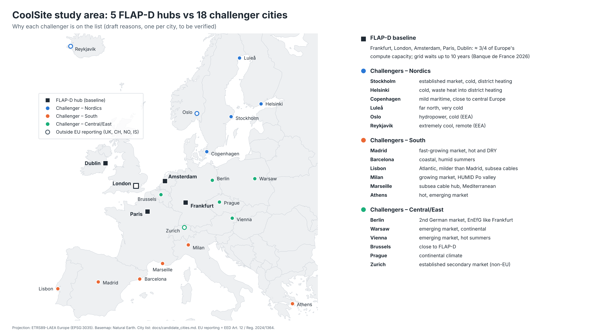
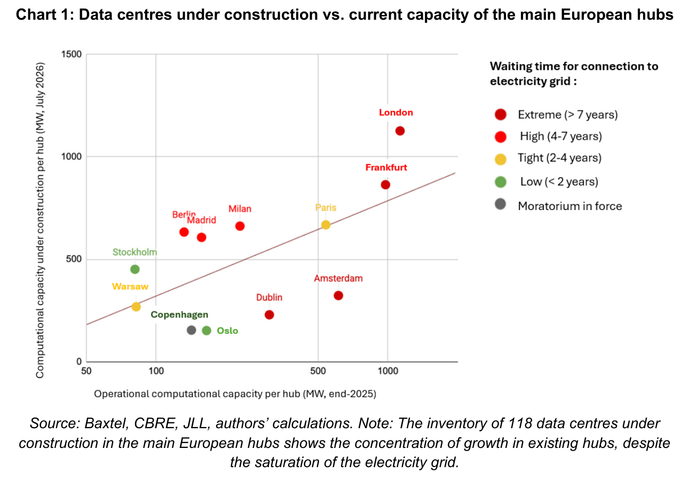
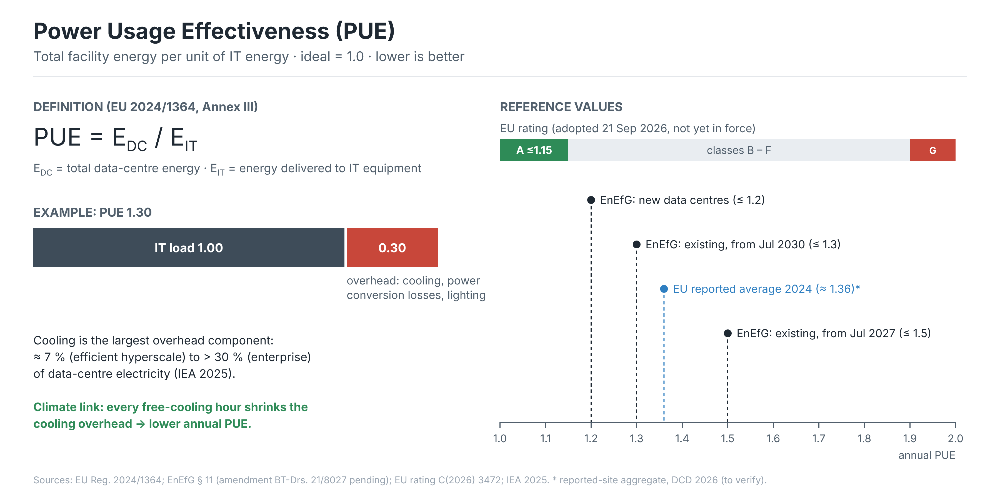
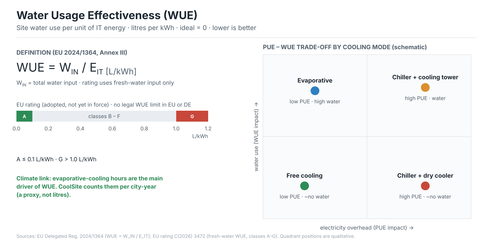
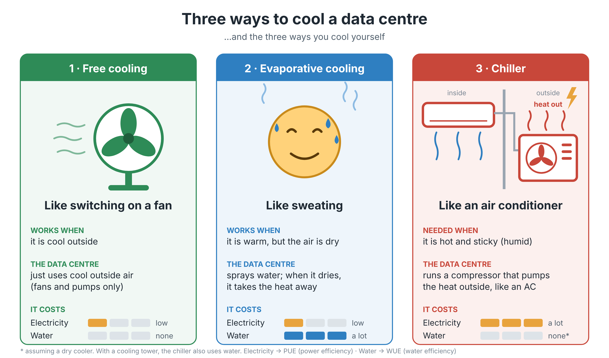
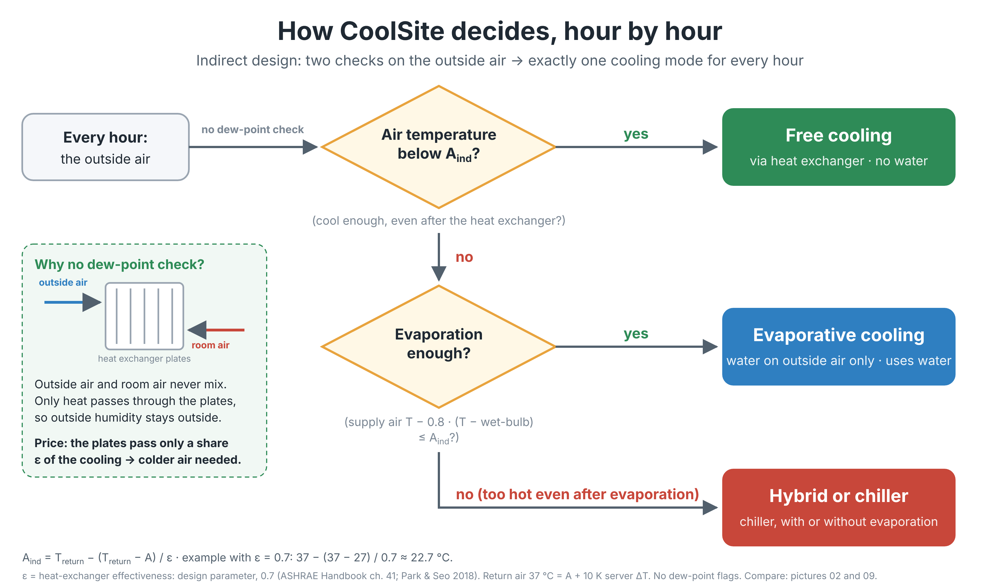
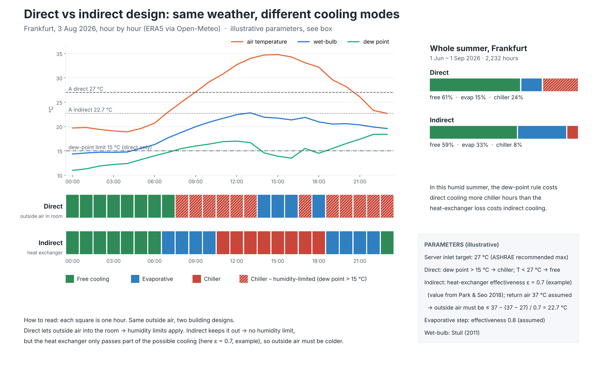
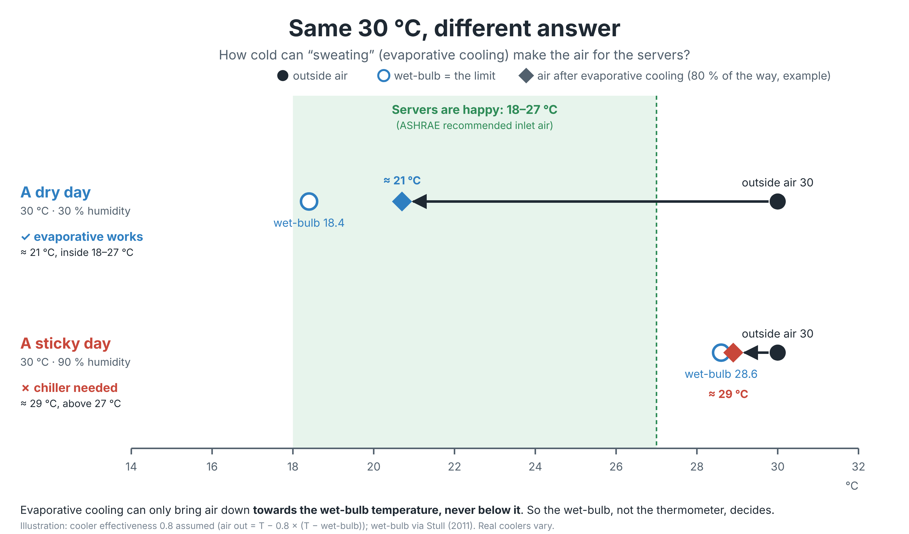
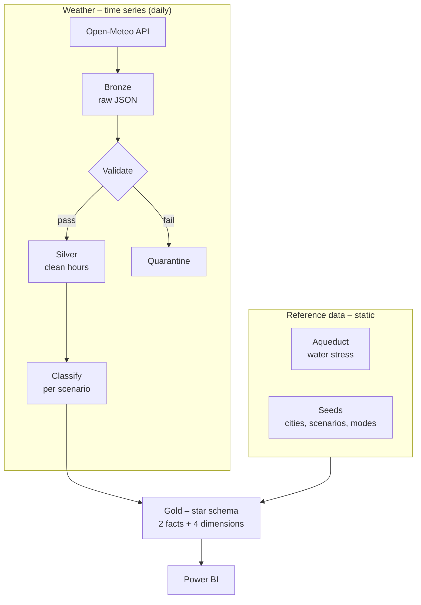

# CoolSite

> Free cooling, water or chillers? A climate pipeline for European data-centre siting.

Business requirements · Last updated: 2026-11-23
City selection: [cities.md](cities.md) · Architecture: [architecture.md](architecture.md) · Data model: [data_model.md](data_model.md) · Data quality: [data_contract.md](data_contract.md)

> **Key question:** Does a city's climate let a data centre save electricity, save water — or both?

CoolSite takes hourly weather data (ERA5 reanalysis via the Open-Meteo API, from 1961), classifies **every hour** into one cooling mode, and aggregates the hours per city and year. It compares the five established **FLAP-D** hubs (Frankfurt, London, Amsterdam, Paris, Dublin) with challenger cities across Europe.

*Study area: 5 FLAP-D hubs + 18 challenger cities. Selection rule: [cities.md](cities.md).*

## 1. The problem

Companies planning new data centres look beyond the FLAP-D markets, because those markets are short of **grid capacity** — and, in some hubs, of sites that have both power and planning permission (e.g. Frankfurt's data-centre zones, Amsterdam's restrictions).

After the servers, **cooling is the largest energy use** of a data centre — about 7 % in efficient hyperscale sites up to over 30 % in less efficient enterprise sites (IEA 2025). The outside climate decides **how** a site can be cooled.

Regulation puts numbers on this: Germany's Energy Efficiency Act (EnEfG) caps PUE (new data centres ≤ 1.2); the EU will grade PUE (electricity) and WUE (water) on an A–G label — **without adjusting for climate**. A site-selection team therefore needs a climate answer.

**Questions CoolSite answers**
- Does this city's climate let a data centre save electricity, save water — or both?
- How has this balance changed from 1961–1990 to today?

Saving water matters most where water is scarce. CoolSite therefore adds each city's **water stress** (WRI Aqueduct 4.0): the same evaporative hours weigh more in Madrid than in Oslo.

**User:** a site-selection team deciding where to build a new data centre.

**Output**
- Gold layer as a **star schema**: hours, water degree-hours and chiller degree-hours per city × year × scenario × mode, plus data coverage per city × year; dimensions for city (incl. water stress), year, scenario and mode → [data_model.md](data_model.md).
- Power BI dashboard comparing FLAP-D and challenger cities, filterable by regulatory zone (EU / EEA / non-EU) and cooling scenario.

## 2. Why siting is changing

Storyline: **power → AI flexibility → regulation → cooling**. CoolSite measures the last step; the first three explain why it matters now.

**Grid power is the bottleneck in FLAP-D**
- FLAP-D holds about **three quarters of Europe's installed compute** and still attracts most new construction.
- Grid connection waits of **up to 10 years** in Frankfurt and London; Dublin's data centres use 20 % of Ireland's electricity.

*Banque de France, Eco Notepad 470 (Nasr & Toulouse, 4 Nov 2026), Chart 1. x-axis: capacity running (MW, log scale); y-axis: under construction; colour: grid waiting time.*

**AI training can move**
- 2030 projection (McKinsey, cited by BdF): 28 % of data-centre electricity for AI training, 43 % inference, 29 % non-AI. Training does not need to be near users → about **54 % of demand could be relocated**.
- Electricity is up to 60 % of operating costs of AI data centres → power price and cooling overhead gain weight, latency loses weight.

**Regulation puts a number on efficiency**
- **Germany (EnEfG, in force):** PUE ≤ 1.2 for new sites; ≤ 1.5 (2027) / ≤ 1.3 (2030) for existing sites. Amendment BT-Drs. 21/8027 pending.
- **EU:** mandatory reporting (Reg. 2024/1364), per-site data confidential; A–G rating for PUE and WUE adopted but not yet in force; no WUE limit anywhere.

## 3. The two efficiency numbers

*Per-site PUE/WUE are confidential under EU law — so CoolSite compares cities through their **climate**, which drives both numbers.*

## 4. Cooling is where climate enters the bill

Three ways to remove the heat: **cold air → free cooling** (like a fan: no water, little electricity); **warm but dry air → evaporative cooling** (like sweating: uses water); **hot or humid air → chiller** (like an air conditioner: lots of electricity). The weather of every hour decides which one is possible.

## 5. Two designs: direct and indirect

How CoolSite classifies each hour depends on how the data centre uses the outside air:

- **Direct** — outside air goes into the server room → its humidity matters → dew-point check first.
- **Indirect** (scenario) — a heat exchanger keeps outside air out → no humidity limit, but the exchanger passes only a share ε of the cooling → stricter thresholds.

**Direct design**

*Too humid → water condenses on cold surfaces → the air must be dried (electricity). Too dry → static electricity → humidifiers (water). Real example: Meta Luleå uses direct outside air with 78 humidifiers.*

**Indirect design**

**Both designs on the same weather — first test with real data**

*Frankfurt, summer 2026, **illustrative parameters** (A = 27 °C, ε = 0.7 as an example value, return air 37 °C). In this humid summer the dew-point rule cost the direct design more chiller hours than the heat-exchanger loss cost the indirect design.*

## 6. Common to both designs: the wet-bulb temperature

Evaporative cooling can only bring air down **towards the wet-bulb temperature**, never below it. The wet-bulb is calculated from temperature and humidity (Stull 2011) — so the thermometer alone cannot decide the cooling mode.

## 7. Thresholds and scenarios

**ASHRAE** (American Society of Heating, Refrigerating and Air-Conditioning Engineers) publishes, through its committee TC 9.9, the reference guidelines for the air entering servers. They are recommendations, not law, but the de-facto design reference — also in Europe.

- CoolSite's starting values = ASHRAE **recommended** range: inlet air 18–27 °C, dew point −9 … 15 °C.
- Evaporative cooling is judged by the supply air it can deliver: **T − ε_evap · (T − wet-bulb)** must reach A (ε_evap = 0.8, ASHRAE Handbook ch. 41). Indirect-design parameters: heat-exchanger effectiveness 0.7, return air 37 °C (sources in [data_model.md](data_model.md)).
- **Every threshold lives in a scenario table** (`data/seed/dim_scenario.csv`), nothing is hard-coded → a new assumption is a new row, and gold is recomputed from silver without re-downloading.

Each design runs **with and without a hybrid mode** (evaporative pre-cooling + chiller trim) → **4 scenarios**. Per hour CoolSite also records **degree-hours** (K·h): how far the outside air is above the threshold, split into the part done with water and the part done by the chiller – a proxy for water and electricity demand, not litres or kWh.

A site-selection team can therefore compare scenarios side by side – for example, what disabling the hybrid mode costs in chiller degree-hours – and every number is traceable to the assumptions behind it.

## 8. Water stress: a second, different data source

- **What:** baseline water stress per river basin from WRI Aqueduct 4.0, annual and monthly, on a 0–5 scale.
- **How:** static reference data, loaded once. Each city point is joined to the river basin it lies in (spatial join) and the result is stored in `dim_city`. A deliberate contrast to the daily weather time series.
- **Why it matters in practice:** the same evaporative hours weigh more where water is scarce. Operators assess water risk at site selection. Equinix committed in 2023 to avoid evaporative cooling in areas with high water stress; Google chose air cooling for its Mesa (Arizona) site because the local water source was at high risk of depletion.
- **Limit:** a screening indicator at river-basin scale, not a local water-utility assessment.

## 9. Pipeline and technology

| Layer | What happens |
|---|---|
| **Source** | Open-Meteo Historical Weather API, model pinned to ERA5-Land: temperature, relative humidity, dew point, hourly. Backfill 1961–2025; then a daily **incremental** load from *watermark − 7 days* to *today − 7 days* (the newest days arrive late and can be revised). Retry with backoff on 429/5xx; a daily-quota error stops the run cleanly. |
| **Bronze** | Raw API response, one immutable JSON file per city × load window (`…__fetched_<UTC timestamp>.json`) → any layer can be rebuilt. |
| **Validation** | Versioned data contract (v0.6.1), 9 rules: structural gate → dataset checks (time range, duplicates, gaps) → row rules (nulls, value ranges, dew point ≤ temperature). Rejected hours go to **quarantine** with rule IDs, never deleted silently. Error budget: ≤ 2 unusable hours per file; a city-year is flagged incomplete below 99.9 % valid hours. |
| **Silver** | One row per city × hour (UTC) plus wet-bulb (Stull 2011) and lineage (run_id, processed_at). Incremental runs **upsert** on (city, time) through a staging folder; the watermark only moves after a successful write ([ADR-002](adr/ADR-002-incremental-loading.md)). |
| **Gold** | Star schema, recomputed from silver: `classify` runs once per scenario row. `fact_cooling_hours` (city × year × scenario × mode), `fact_city_year` (city × year: total and expected hours), `dim_city` (incl. water stress), `dim_year`, `dim_scenario`, `dim_mode`. |
| **Dashboard** | Power BI Desktop (on an Azure Windows VM); ratios such as mode share and coverage are computed as measures, never stored. |

**Engine and platform**
- **PySpark + Spark SQL**, built and tested **locally first** (guaranteed, gradable fallback), then migrated to **Azure Databricks** – same engine, no rewrite. Water stress is prepared once with GeoPandas (spatial join) and stored as a seed.
- **Why Databricks and Azure:** Databricks on Azure is the state of the art for data engineering in the Stuttgart region. Technically, it fits the pipeline's operation rather than its size: **Delta Lake `MERGE`** for safe, idempotent upserts of late and corrected data; **Unity Catalog** for access control and lineage; **scheduled jobs** that do not depend on a laptop; one governed place the dashboard reads from.
- Portability rules: logic separate from I/O, all paths and thresholds in config, secrets only in environment variables, Git from the start.
- **Tests (pytest):** classification incl. degree-hours, wet-bulb, validation rules, incremental windows, retry, upsert, coverage, mode counts; a failure demo shows recovery after a run with missing recent data.

## 10. First results (23 cities, 1961–2026)

Share of hours per cooling mode, direct design:

| City | Period | Free | Evaporative | Chiller |
|---|---|---|---|---|
| Frankfurt | 1961–1990 | 93.9 % | 0.6 % | 5.5 % |
| Frankfurt | 2016–2025 | 90.2 % | 1.8 % | 8.0 % |
| Madrid | 1961–1990 | 91.4 % | 8.1 % | 0.5 % |
| Madrid | 2016–2025 | 86.3 % | 12.7 % | 1.1 % |
| Milan | 1961–1990 | 82.8 % | 0.7 % | 16.4 % |
| Milan | 2016–2025 | 75.0 % | 1.6 % | 23.4 % |
| Oslo | 1961–1990 | 97.8 % | 0.2 % | 2.0 % |
| Oslo | 2016–2025 | 94.1 % | 0.5 % | 5.4 % |

- **Free cooling is shrinking everywhere**, by about 3–8 percentage points between 1961–1990 and 2016–2025.
- **Dry heat vs humid heat:** Madrid shifts towards **water** (evaporative), Milan towards **electricity** (chiller).
- **In the direct design, humidity – not heat – switches the chiller on:** every direct chiller hour in the 23 cities is humidity-limited; the direct design never needs a hybrid mode with the ASHRAE recommended dew-point limit.
- **Indirect design:** with evaporative assist, a pure chiller is never needed; without it, the same hours become chiller hours.
- **Water stress:** 14 of 23 cities never reach "extremely high" water stress in any month; Madrid and Barcelona do in 10 months of the year.
- **Data checks on gold:** no duplicate keys; per city × year × scenario, the hours of all modes add up exactly to the hours in silver; only the current year (2026) is flagged incomplete.

## 11. MVP, status, risks and scope

**MVP** (must work by 15 December)
- Hourly cooling-mode classification for the **23 European cities**, 1961 to today, in 4 scenarios (direct / indirect × with / without hybrid mode), with degree-hours
- Validated, incremental pipeline (bronze → silver → gold star schema) running on **Azure Databricks**
- Water stress per city (WRI Aqueduct 4.0) in `dim_city`
- **Power BI dashboard** answering: how much free cooling, water vs electricity, and the change since 1961–1990

**Extensions** (low cost – the pipeline already handles them; only if time allows)
- **83 global outlook cities:** bronze already loaded; included once their data-quality checks pass (quarantine rate, coverage, coastal grid cells)
- Liquid-cooling and no-water scenarios · cross-check against station data (Meteostat) · threshold slider in the dashboard

**Decided**
- Core: hourly cooling-mode classification (free / evaporative / hybrid / chiller) with degree-hours
- 4 scenarios: direct and indirect design, each with and without hybrid mode; ASHRAE recommended values as starting thresholds
- Gold as a star schema; ratios computed in the dashboard
- Data contract v0.6.1 with quarantine and error budget; incremental loading with watermark, lookback and upsert
- City list: 23 European cities (project) + 83 global cities (outlook); rule in [cities.md](cities.md)
- Water stress (WRI Aqueduct 4.0) as a second, static data source in `dim_city`
- Local PySpark first → Azure Databricks; dashboard in Power BI

**Next**
- Star-schema data tests (unique keys, referential integrity, balance) as pytest
- Zero-hour modes: one row per mode even when a mode has 0 hours
- Migration to Azure Databricks (Delta tables, scheduled job, Unity Catalog)
- Power BI dashboard

**Risks and assumptions**
- **ERA5-Land is a model, not a measurement** (0.1° grid): local effects such as urban heat are smoothed → planned Meteostat cross-check.
- **Degree-hours are a proxy**, not kWh or litres. Cool but humid hours run the chiller yet add 0 chiller degree-hours → reported separately as `humidity_limited_hours`.
- **Wet-bulb is an approximation (Stull 2011):** an empirical fit, valid for 5–99 % relative humidity and −20 to 50 °C at sea-level pressure (1013.25 hPa), not for cold *and* dry air together; error −1 to +0.65 °C, mean absolute error < 0.3 °C. Silver check (13.1 M hours): only 328 hours have wet-bulb above air temperature, all at > 95 % humidity or below 0 °C, max 0.14 °C — cold hours are free cooling anyway, so no cooling mode changes.
- **Thresholds are assumptions** (ASHRAE recommended range, ε values from literature) → kept as scenarios, not hidden in code.
- **One point per city**: water stress and climate are taken at the city centre, not at an actual data-centre site.
- **Recent data arrives late** and can be revised → load up to today − 7 days, re-read the last 7 days.
- **API quota** (10,000 weighted calls per day, free tier, non-commercial) → resumable backfill with a daily budget.
- **Cloud cost and trial limits** on Azure → budget alert, single-node auto-terminating cluster, local pipeline as fallback.

**Out of scope:** grid waiting time, electricity prices, fibre, permits, land; per-facility PUE/WUE (confidential). CoolSite answers the **climate** part of the siting decision; grid waiting time is a candidate future layer.

**Main sources:** Banque de France Eco Notepad 470 (2026) · IEA *Energy and AI* (2025) · ASHRAE TC 9.9 Thermal Guidelines (2016) · EU Reg. 2024/1364 · EnEfG § 11 · Park & Seo (2018) · Stull (2011) · CBRE Global Data Center Trends 2026 · Condair (2014) · WRI Aqueduct 4.0 (Kuzma et al. 2023) · Equinix, *How data centers use water* (2024) · Google Cloud, *Assessing watershed health in data center host communities* (2023).
