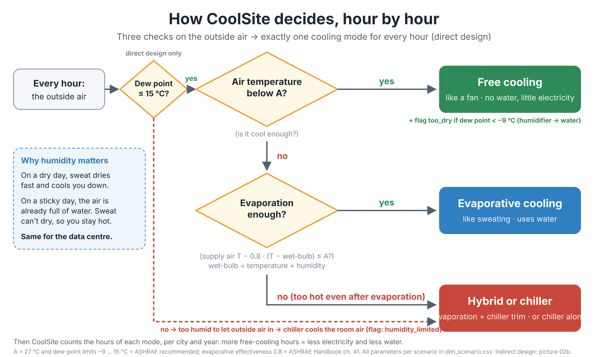
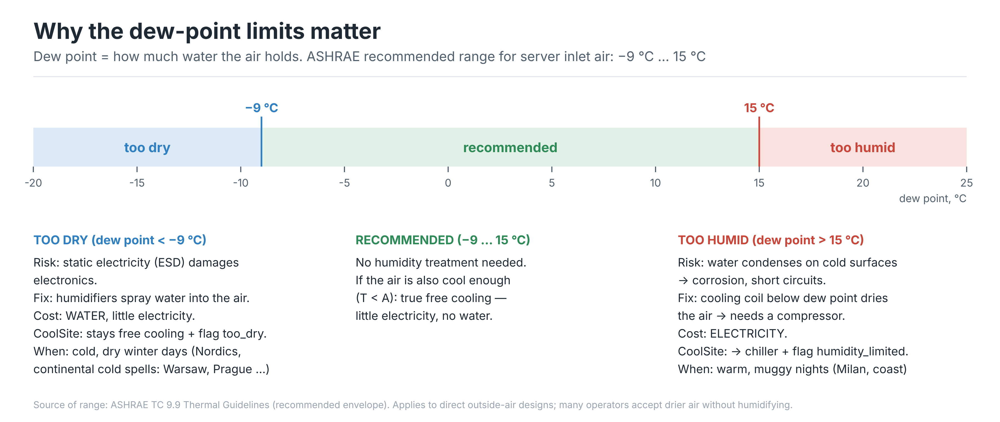
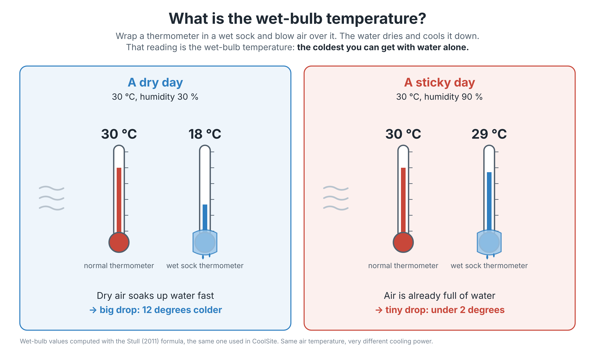

# CoolSite

> Free cooling, water or chillers? A climate pipeline for European data-centre siting.

Status: business requirements DRAFT v4 (short version, same structure as `CoolSite_capstone_idea.pdf`) · Last updated: 2026-11-10
Details (full research notes, dated decision log, open items, all sources): [capstone_details.md](capstone_details.md) · Data quality: [data_contract.md](data_contract.md)

> **Key question:** Does a city's climate let a data centre save electricity, save water — or both?

CoolSite takes hourly weather data (ERA5 reanalysis via the Open-Meteo API, from 1961), classifies **every hour** into one cooling mode, and aggregates the hours per city and year. It compares the five established **FLAP-D** hubs (Frankfurt, London, Amsterdam, Paris, Dublin) with challenger cities across Europe.

*Study area (current draft): 5 FLAP-D hubs + 18 challenger cities. The city list is not final — see section 8.*

## 1. The problem

Companies planning new data centres look beyond the FLAP-D markets, because those markets are short of **grid capacity** — and, in some hubs, of sites that have both power and planning permission (e.g. Frankfurt's data-centre zones, Amsterdam's restrictions).

After the servers, **cooling is the largest energy use** of a data centre — about 7 % in efficient hyperscale sites up to over 30 % in less efficient enterprise sites (IEA 2025). The outside climate decides **how** a site can be cooled.

Regulation puts numbers on this: Germany's Energy Efficiency Act (EnEfG) caps PUE (new data centres ≤ 1.2); the EU will grade PUE (electricity) and WUE (water) on an A–G label — **without adjusting for climate**. A site-selection team therefore needs a climate answer.

**Questions CoolSite answers**
- Does this city's climate let a data centre save electricity, save water — or both?
- How has this balance changed from 1961–1990 to today?

**User:** a company deciding where to build a new data centre (site-selection team).

**Output**
- Gold table per city × year: hours and **shares** of free cooling / evaporative / chiller, plus data coverage.
- Dashboard comparing FLAP-D and challenger cities, filterable by regulatory zone (EU / EEA / non-EU).

## 2. Why siting is changing

Storyline: **power → AI flexibility → regulation → cooling**. CoolSite measures the last step; the first three explain why it matters now.

**Grid power is the bottleneck in FLAP-D**
- FLAP-D holds about **three quarters of Europe's installed compute** and still attracts most new construction.
- Grid connection waits of **up to 10 years** in Frankfurt and London; Dublin's data centres use 20 % of Ireland's electricity.

*Banque de France, Eco Notepad 470 (Nasr & Toulouse, 4 Nov 2026), Chart 1. x-axis: capacity running (MW, log scale); y-axis: under construction; colour: grid waiting time.*

**AI training can move**
- 2030 projection (McKinsey, cited by BdF): 28 % of data-centre electricity for AI training, 43 % inference, 29 % non-AI. Training does not need to be near users → about **54 % of demand could be relocated**.
- Electricity is up to 60 % of operating costs of AI data centres → power price and cooling overhead gain weight, latency loses weight.

**Regulation puts a number on efficiency**
- **Germany (EnEfG, in force):** PUE ≤ 1.2 for new sites; ≤ 1.5 (2027) / ≤ 1.3 (2030) for existing sites. Amendment BT-Drs. 21/8027 pending.
- **EU:** mandatory reporting (Reg. 2024/1364), per-site data confidential; A–G rating for PUE and WUE adopted but not yet in force; no WUE limit anywhere.

## 3. The two efficiency numbers

*Per-site PUE/WUE are confidential under EU law — so CoolSite compares cities through their **climate**, which drives both numbers.*

## 4. Cooling is where climate enters the bill

**Thresholds come from ASHRAE — and everything is a parameter**

**ASHRAE** (American Society of Heating, Refrigerating and Air-Conditioning Engineers) publishes, through its committee TC 9.9, the reference guidelines for the air entering servers. They are recommendations, not law, but the de-facto design reference — also in Europe.

- CoolSite's starting values = ASHRAE **recommended** range: inlet air 18–27 °C, dew point −9 … 15 °C.
- Not from ASHRAE: the wet-bulb threshold B (source still open) and the indirect-design parameters.
- **Every threshold lives in the config**, nothing is hard-coded → scenarios (e.g. ASHRAE allowable instead of recommended, safety margins) can be compared by re-running the pipeline.

## 5. Two designs: direct and indirect

How CoolSite classifies each hour depends on how the data centre uses the outside air:

- **Direct** (MVP) — outside air goes into the server room → its humidity matters → dew-point check first.
- **Indirect** (scenario) — a heat exchanger keeps outside air out → no humidity limit, but the exchanger passes only a share ε of the cooling → stricter thresholds.

**Direct design (MVP)**

*Too humid → water condenses on cold surfaces → the air must be dried (electricity). Too dry → static electricity → humidifiers (water). Real example: Meta Luleå uses direct outside air with 78 humidifiers.*

**Indirect design (scenario after the MVP)**

**Both designs on the same weather — first test with real data**

*Frankfurt, summer 2026, **illustrative parameters** (A = 27 °C, ε = 0.7 as an example value, return air 37 °C). In this humid summer the dew-point rule cost the direct design more chiller hours than the heat-exchanger loss cost the indirect design.*

## 6. Common to both designs: the wet-bulb temperature

Evaporative cooling can only bring air down **towards the wet-bulb temperature**, never below it. The wet-bulb is calculated from temperature and humidity (Stull 2011) — so the thermometer alone cannot decide the cooling mode.

## 7. Pipeline and technology

| Layer | What happens |
|---|---|
| **Source** | Open-Meteo Historical Weather API (ERA5, hourly since 1940, ~5-day delay): temperature, relative humidity, dew point. Backfill from 1961; each run reloads the last ~7 days (idempotent overwrite). |
| **Bronze** | Raw API response per city and load, unchanged (JSON). |
| **Validation** | Versioned data contract (v0.4) with 9 checks: structural gate (fields, timezone) → dataset checks (time range, duplicates, gaps) → row rules (nulls, value ranges, dew point ≤ temperature). Bad rows are quarantined with rule IDs, never deleted silently. Error budget: ≤ 2 unusable hours per file; a city-year counts only with ≥ 99.9 % valid hours. |
| **Silver** | One row per city × hour, typed (UTC), plus wet-bulb and the cooling mode. |
| **Gold** | Per city × year (× design): hours and shares of each mode, coverage, humidity flags. Check: the three modes add up to the valid hours. |

**Engine and platform**
- **PySpark + Spark SQL**, built and tested **locally first** (guaranteed, gradable fallback), then migrated to **Azure Databricks** (plan B: Databricks Free Edition) — same engine, no rewrite.
- **Why Databricks and Azure:** the choice follows the **job-market requirements in the Stuttgart region**, where data-engineering roles frequently ask for Databricks, Azure and PySpark.
- Portability rules: logic separate from I/O, all paths and thresholds in config, secrets only in environment variables, Git from the start.

## 8. Status: decided, open, out of scope

**Decided**
- Core: hourly cooling-mode classification (free / evaporative / chiller)
- Direct design for the MVP; indirect as a parameter-driven scenario
- ASHRAE recommended values as starting thresholds; all thresholds configurable
- Metrics as shares of valid hours, with coverage
- Data contract v0.4 with quarantine and error budget
- Local PySpark first → Azure Databricks

**Still open**
- **City list:** the 23 cities are a draft — the selection can still be narrowed, broadened or scaled (inclusion rule pending)
- **Scope:** can grow (more cities, climate projections to 2050, extra layers such as grid waiting time or water stress) or shrink to fit the timeline
- Source and method for the wet-bulb threshold B
- Sources for return-air temperature and cooler effectiveness
- MVP size: start with 3 cities (Frankfurt + 1 cold + 1 hot), then scale

**Out of scope:** grid waiting time, electricity prices, fibre, permits, land; per-facility PUE/WUE (confidential). CoolSite answers the **climate** part of the siting decision; grid waiting time is a candidate future layer.

**Main sources:** Banque de France Eco Notepad 470 (2026) · IEA *Energy and AI* (2025) · ASHRAE TC 9.9 Thermal Guidelines (2016) · EU Reg. 2024/1364 · EnEfG § 11 · Park & Seo (2018) · Stull (2011) · CBRE Global Data Center Trends 2026 · Condair (2014). Full list with links: [capstone_details.md](capstone_details.md#e-sources).
