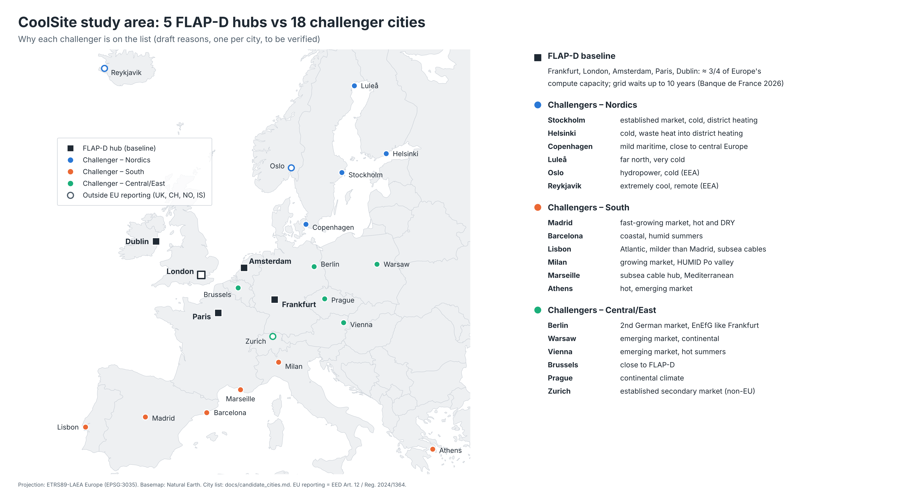

# CoolSite – city selection

The source of truth is `data/seed/city_list_all.csv` (one row per city, with a `reason`); `src/build_cities.py` adds coordinates, timezone and climate class → `data/seed/cities_all.csv`.

CoolSite uses **two scopes with two different purposes**:

| Scope | Cities | Purpose |
|---|---|---|
| `project` | 23 European cities | the main story: FLAP-D hubs vs. challengers |
| `outlook` | 83 global cities | shows that the method scales beyond Europe; not part of the main story |

## 1. Project scope (23 cities)

**Baseline – the 5 FLAP-D hubs** (Frankfurt, London, Amsterdam, Paris, Dublin). They hold most of Europe's installed capacity and are running out of grid power, which is why operators look elsewhere.

**Challengers – 18 cities.** A challenger must meet both conditions:

1. **It is an existing or emerging data-centre market.** 14 of the 18 challengers appear in a regional top-10 list of Cushman & Wakefield's *Global Data Center Market Comparison 2026*; Berlin and Warsaw appeared in the 2025 edition's emerging markets.
2. **Together, the challengers cover Europe's climate types** (Köppen: BSk cold semi-arid, Cfa humid subtropical, Cfb oceanic, Cfc subpolar oceanic, Csa hot-summer Mediterranean, Csb warm-summer Mediterranean, Dfb humid continental, Dfc subarctic) and its regions: north, south, centre and east.

**Climate extremes.** Luleå (subarctic; an existing outside-air-cooled hyperscale site) and Lisbon (Atlantic Mediterranean) were added to cover the cold and the mild-Mediterranean ends of the range.

**Not used for selection: the C&W rank.** C&W does not publish how markets are assigned to tiers, and its ranking already includes power availability and construction pipeline – factors CoolSite does not measure. The report is used only to confirm that a city is a real data-centre market. Its tier and rank are kept as descriptive columns (`cw2026_tier`, `cw2026_rank`); a rank is only comparable within the same region and tier.

| City | Country | Zone | Group | Climate (Köppen) | C&W 2026 (EMEA) | Reason |
|---|---|---|---|---|---|---|
| Frankfurt | DE | EU | FLAP-D | Cfb (oceanic) | – | reference city; largest German hub; EnEfG PUE caps apply |
| London | GB | non-EU | FLAP-D | Cfb (oceanic) | – | FLAP-D baseline; long grid connection waits; outside EU reporting |
| Amsterdam | NL | EU | FLAP-D | Cfb (oceanic) | – | FLAP-D baseline; temporary moratorium on new data centres (2019) |
| Paris | FR | EU | FLAP-D | Cfb (oceanic) | primary #10 | FLAP-D baseline; major market |
| Dublin | IE | EU | FLAP-D | Cfb (oceanic) | – | FLAP-D baseline; data centres use about 20 % of Ireland's electricity |
| Stockholm | SE | EU | challenger | Dfb (humid continental) | primary #6 | established market; cold; district heating for waste heat |
| Helsinki | FI | EU | challenger | Dfb (humid continental) | primary #1 | cold; waste-heat reuse in district heating |
| Copenhagen | DK | EU | challenger | Cfb (oceanic) | secondary #5 | mild maritime; close to central Europe |
| Luleå | SE | EU | challenger | Dfc (subarctic) | – | far north; very cold; Meta outside-air cooling site |
| Oslo | NO | EEA | challenger | Dfb (humid continental) | primary #2 | hydropower; cold |
| Reykjavik | IS | EEA | challenger | Cfc (subpolar oceanic) | secondary #1 | extremely cool; remote |
| Madrid | ES | EU | challenger | BSk (cold semi-arid) | primary #5 | fast-growing market; hot and dry (pair with Milan) |
| Barcelona | ES | EU | challenger | Csa (hot-summer Mediterranean) | tertiary #6 | coastal; humid summers |
| Lisbon | PT | EU | challenger | Csb (warm-summer Mediterranean) | – | Atlantic; milder than Madrid; subsea cables |
| Milan | IT | EU | challenger | Cfa (humid subtropical) | primary #4 | growing market; humid Po valley (pair with Madrid) |
| Marseille | FR | EU | challenger | Csa (hot-summer Mediterranean) | tertiary #1 | subsea cable hub; Mediterranean |
| Athens | GR | EU | challenger | Csa (hot-summer Mediterranean) | secondary #3 | hot; emerging market |
| Berlin | DE | EU | challenger | Cfb (oceanic) | – | second German market; EnEfG applies like Frankfurt |
| Warsaw | PL | EU | challenger | Dfb (humid continental) | – | emerging market; continental |
| Vienna | AT | EU | challenger | Cfb (oceanic) | secondary #2 | emerging market; hot summers |
| Brussels | BE | EU | challenger | Cfb (oceanic) | tertiary #7 | close to FLAP-D |
| Prague | CZ | EU | challenger | Cfb (oceanic) | tertiary #4 | continental |
| Zurich | CH | non-EU | challenger | Cfb (oceanic) | primary #9 | established secondary market; outside the EU |

Zone = regulatory zone: EU (EU data-centre reporting applies), EEA (Norway, Iceland), non-EU.

## 2. Outlook scope (83 cities)

Markets listed in Cushman & Wakefield's *Global Data Center Market Comparison* (2026 edition, plus some from 2025), across all three C&W regions: Americas 40, APAC 30, EMEA 13. One point per market (e.g. Ashburn for Northern Virginia). These cities run through the same pipeline; the dashboard shows them as an option, while the default filter is `scope = project`.

## 3. Columns used for selection and filtering

| Column | Meaning |
|---|---|
| `scope` | `project` or `outlook` |
| `my_group` | CoolSite's own grouping: `FLAP-D` / `challenger` (project scope) |
| `regulatory_zone` | EU / EEA / non-EU |
| `cw_region` | Americas / APAC / EMEA |
| `cw2026_tier`, `cw2026_rank` | C&W 2026 tier and rank within its region's top-10 list; empty if not listed |
| `reason` | one-line reason for including the city |

Source: Cushman & Wakefield, *Global Data Center Market Comparison* (2025, 2026). Names, tiers and ranks only; see `governance.md`.
