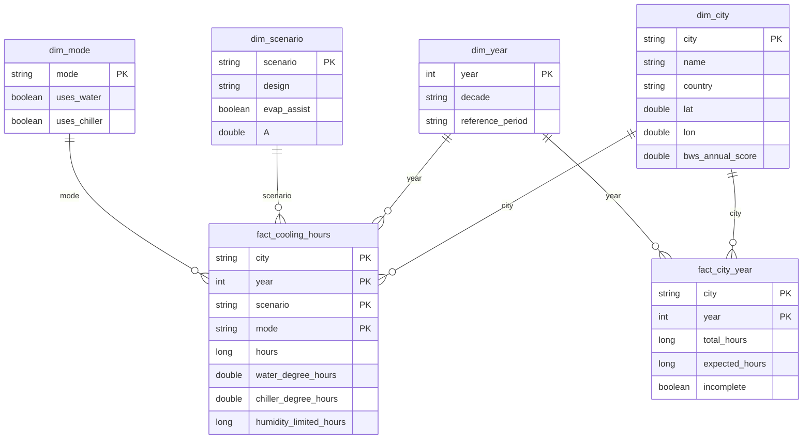

# CoolSite – data model

Purpose, grain, keys and relationships of every table. Star schema designed 2026-11-20. Field rules and quality checks: see `data_contract.md`.

Status legend: ✅ built · 🟡 seed file exists, not yet wired into the pipeline · ⬜ planned

## 1. Overview

```
Open-Meteo API (ERA5-Land)
        │  ingest.py
        ▼
bronze  (raw JSON, 1 file per city × load window)
        │  validate.py  (DQ-01..09, error budget)
        ├──────────────► quarantine  (rejected hours + rule IDs)
        ▼  transform.py
silver  (1 row per city × hour, + wet-bulb, lineage)
        │  classify.py (per scenario) + aggregate.py
        ▼
gold = star schema
   fact_cooling_hours (city × year × scenario × mode) ──┬── dim_city
   fact_city_year     (city × year)              ───────┤── dim_year
                                                        ├── dim_scenario
                                                        └── dim_mode
        │
        ▼
dashboard (Power BI Desktop on an Azure Windows VM)

seeds (data/seed/): cities_all.csv, dim_scenario.csv, dim_mode.csv
reference (data/reference/, not in Git): WRI Aqueduct 4.0 → water stress in dim_city
```

## 2. Tables

### Pipeline layers

| Table | Grain (one row =) | Key | Stored as / partitioned by | Purpose | Status |
|---|---|---|---|---|---|
| bronze | one **file** = one city × one load window | city + start + end + fetched_at | JSON, `data/bronze/city=<city>/<start>_<end>__fetched_<YYYYMMDDTHHMMSSZ>.json` | raw API response, never changed → can always reprocess | ✅ |
| silver | one **hour** of one city | city + time | Parquet, `data/silver/`, partitioned by `city`, `year` | validated, clean hours + derived wet-bulb + lineage | ✅ |
| quarantine | one **rejected row** (raw hour) | city + time — *not unique*: conflicting duplicates keep all copies | Parquet, `data/quarantine/`, partitioned by `city`, `year`; append-only | rejected hours with the rule IDs they broke, never deleted silently | ✅ |
| gold `cooling_modes` | one **city × year × design × mode** | city + year + design + mode | Parquet, `data/gold/`, one file | current flat gold table; **replaced by the star schema below** | ✅ (to be replaced) |

### Gold: star schema

Facts hold keys and measures; dimensions hold descriptions. Measures that are ratios (mode share, coverage) are never stored – they are computed in the dashboard (DAX) as `SUM(...) / SUM(...)`.

| Table | Type | Grain (one row =) | Key | Source | Status |
|---|---|---|---|---|---|
| `fact_cooling_hours` | fact | one city, one year, one scenario, one mode | city + year + scenario + mode | silver → `classify` per scenario → count | ⬜ |
| `fact_city_year` | fact | one city, one year | city + year | silver → count hours | ⬜ |
| `dim_city` | dimension | one city | city | `data/seed/cities_all.csv` + Aqueduct spatial join + `iso3` | ⬜ |
| `dim_year` | dimension | one calendar year | year | generated (1961 → current year) | ⬜ |
| `dim_scenario` | dimension | one cooling scenario (design + parameter set) | scenario | `data/seed/dim_scenario.csv` | 🟡 |
| `dim_mode` | dimension | one cooling mode | mode | `data/seed/dim_mode.csv` | 🟡 |

### ER diagram (gold)



`||--o{` = one row in the dimension, zero or many rows in the fact. Only the main columns are shown; full column lists in §4.

## 3. Relationships

- bronze → silver: one bronze file produces the silver rows of one city-year partition (via `validate` + `transform`, upsert on city + time). Hours that fail a rule go to quarantine instead.
- silver → gold: gold is fully recomputed from all of silver. `build_gold` loops over the rows of `dim_scenario` and runs `classify` with that row's parameters.
- Star schema joins (all many-to-one, natural keys):
  - `fact_cooling_hours.city` → `dim_city.city`, `.year` → `dim_year.year`, `.scenario` → `dim_scenario.scenario`, `.mode` → `dim_mode.mode`
  - `fact_city_year.city` → `dim_city.city`, `.year` → `dim_year.year`
- Balance rule between the two facts: every valid hour belongs to exactly one mode per scenario → for each city × year × scenario, `SUM(fact_cooling_hours.hours) = fact_city_year.total_hours`.

## 4. Columns

### silver
| Column | Type | Unit | Meaning |
|---|---|---|---|
| city | string | — | city slug, lowercase (partition column) |
| year | int | — | calendar year of `time`, UTC (partition column) |
| time | timestamp | UTC | start of the hour |
| temperature_c | double | °C | air temperature 2 m |
| humidity_pct | int | % | relative humidity 2 m |
| dew_point_c | double | °C | dew point 2 m |
| wet_bulb_c | double | °C | wet-bulb temperature, Stull (2011), computed in silver |
| source_model | string | — | weather model, `era5_land` |
| contract_version | string | — | data contract version used to validate the row |
| processed_at | timestamp | UTC | when the row was written to silver |
| run_id | string | — | id of the pipeline run that wrote the row (also in the log) |

### quarantine
| Column | Type | Meaning |
|---|---|---|
| city, time, temperature_c, humidity_pct, dew_point_c | as silver | the rejected hour as read from bronze |
| failed_rules | array<string> | IDs of the broken rules, e.g. `["DQ-07"]`, `["DQ-04"]` |
| run_id, processed_at | string, timestamp | which run rejected the row, and when |
| year | int | partition column |

### fact_cooling_hours ⬜
| Column | Type | Meaning |
|---|---|---|
| city | string | key → dim_city |
| year | int | key → dim_year |
| scenario | string | key → dim_scenario |
| mode | string | key → dim_mode |
| hours | long | number of valid hours in this mode (additive) |
| water_degree_hours | double | Σ over the hours of (cooling done with water), K·h – proxy for water demand (additive) |
| chiller_degree_hours | double | Σ over the hours of (cooling done by the chiller), K·h – proxy for chiller electricity (additive) |
| humidity_limited_hours | long | hours in which outside air was too humid to use (direct design); the chiller runs, but cool humid hours add 0 to chiller_degree_hours (additive) |

Degree-hours per hour (from `classify`, a = threshold of the scenario):

| mode | water_degree | chiller_degree |
|---|---|---|
| free | 0 | 0 |
| evaporative | T − a | 0 |
| hybrid | T − supply_after_evap | supply_after_evap − a |
| chiller | 0 | max(T − a, 0) |

### fact_city_year ⬜
| Column | Type | Meaning |
|---|---|---|
| city | string | key → dim_city |
| year | int | key → dim_year |
| total_hours | long | valid hours in silver for this city-year (additive) |
| expected_hours | long | hours the calendar year should have: 8,760 or 8,784 (additive) |
| incomplete | boolean | coverage of this single year < 99.9 %; used as a filter (e.g. hide the current year in trends) |

Coverage over any selection = `SUM(total_hours) / SUM(expected_hours)` (computed, not stored).

### dim_city ⬜
| Column | Type | Meaning |
|---|---|---|
| city | string | key, slug |
| name | string | display name |
| country | string | ISO 3166-1 alpha-2 |
| iso3 | string | ISO 3166-1 alpha-3 (via `pycountry`); join key for country-level data (e.g. Ember) |
| region | string | UN M49 subregion |
| cw_region | string | Americas / APAC / EMEA (Cushman & Wakefield) |
| regulatory_zone | string | EU / EEA / non-EU |
| scope | string | `project` (23 European cities) / `outlook` (global) |
| my_group | string | FLAP-D / challenger / … |
| cw2026_tier | string | primary / secondary / tertiary (C&W 2026), may be empty |
| lat, lon | double | coordinates (Open-Meteo geocoding) |
| timezone | string | IANA timezone |
| climate_class | string | Köppen-Geiger class (Beck et al. 2023) |
| pfaf_id | long | Aqueduct basin the city point falls in (spatial join, `within`) |
| bws_annual_score | double | baseline water stress, annual, 0–5 (Aqueduct layer `baseline_annual`) |
| bws_annual_cat | int | category 0–4 (−1 = arid and low water use) |
| bws_months_ge_4 | int | number of months with monthly water-stress score ≥ 4 (Aqueduct `baseline_monthly`) |

### dim_year ⬜
| Column | Type | Meaning |
|---|---|---|
| year | int | key |
| decade | string | e.g. `1980s` |
| reference_period | string | `1961–1990` / `1991–2020` / `recent` (WMO reference periods) |

### dim_scenario 🟡
One row = one cooling scenario (design + parameter set). Seed: `data/seed/dim_scenario.csv`.
Single source of truth for scenario parameters: `classify` reads its parameters from this table.
Rule: scenario rows are fixed once used; a new assumption gets a new scenario key. Edit a row only to fix a mistake.

| Column | Type | Description |
|---|---|---|
| scenario | string | Key, e.g. `air_direct` |
| sort_order | int | Order in slicers and legends |
| label | string | Display name |
| cooling_type | string | `air` (later: `liquid`) |
| design | string | `direct` or `indirect`; passed to `classify` |
| evap_assist | boolean | Can evaporative pre-cooling run together with the chiller (hybrid mode)? |
| A | double | Max supply air temperature (°C) |
| dew_max | double | Max dew point (°C); direct only, null for indirect |
| dew_min | double | Min dew point (°C); direct only, null for indirect |
| eps_evap | double | Evaporative effectiveness |
| eps_hx | double | Heat-exchanger effectiveness; indirect only, null for direct |
| T_return | double | Return air temperature (°C); indirect only, null for direct |
| description | string | What the scenario assumes |
| source | string | Where the parameter values come from |

Derived in code, not stored in the seed: `threshold_a` (= A for direct; T_return − (T_return − A) / eps_hx ≈ 22.7 °C for indirect).

| scenario | design | evap_assist | A | dew_max | dew_min | eps_evap | eps_hx | T_return |
|---|---|---|---|---|---|---|---|---|
| air_direct | direct | true | 27 | 15 | −9 | 0.8 | – | – |
| air_direct_no_hybrid | direct | false | 27 | 15 | −9 | 0.8 | – | – |
| air_indirect | indirect | true | 27 | – | – | 0.8 | 0.7 | 37 |
| air_indirect_no_hybrid | indirect | false | 27 | – | – | 0.8 | 0.7 | 37 |

Parameter sources:
- A, dew_max, dew_min: ASHRAE TC 9.9 recommended envelope.
- eps_evap = 0.8: ASHRAE Handbook – HVAC Systems and Equipment, ch. 41 (rigid-media direct evaporative coolers 70–95 %); NREL bin analysis assumes 80–90 %.
- eps_hx = 0.7: ASHRAE Handbook ch. 41 (indirect evaporative cooling 40–80 %); Park & Seo (2018).
- T_return = 37 °C: derived as A + 10 K server ΔT (STULZ: servers heat air by 10–15 K). Lower bound → conservative: a higher T_return would give more free-cooling hours.

### dim_mode 🟡
One row = one cooling mode. Seed: `data/seed/dim_mode.csv`.

| Column | Type | Description |
|---|---|---|
| mode | string | Key: `free`, `evaporative`, `hybrid`, `chiller` (must match the values `classify` produces) |
| label | string | Display name |
| uses_water | boolean | Mode uses water (evaporative, hybrid) |
| uses_chiller | boolean | Mode uses the chiller (hybrid, chiller); all modes use some electricity for fans |
| color | string | Hex colour, same in every chart |
| sort_order | int | Order in charts: free → chiller |

| mode | label | uses_water | uses_chiller | color | sort_order |
|---|---|---|---|---|---|
| free | Free cooling | false | false | #107C10 | 1 |
| evaporative | Evaporative cooling | true | false | #0078D7 | 2 |
| hybrid | Evaporative + chiller | true | true | #5C2D91 | 3 |
| chiller | Chiller cooling | false | true | #F18F49 | 4 |

## 5. Design decisions (short)
- **Direct design in Europe: humidity, not heat, forces the chiller on** (2026-11-21). With the ASHRAE recommended dew-point limit (15 °C), the humidity limit always binds before evaporative cooling runs out: 0 hybrid hours in the direct design for all 23 project cities, 1961–2026, so `air_direct` and `air_direct_no_hybrid` give the same result there. Both are kept: in very hot, dry outlook cities (e.g. Riyadh, Dubai, Phoenix) evaporative cooling alone may not be enough even with dry air, so hybrid hours can occur – to verify once their silver data is complete.
- **Indirect: evaporative assist removes the pure chiller** (2026-11-21). `air_indirect` has 0 pure-chiller hours; `air_indirect_no_hybrid` turns the same hours into chiller hours (997 of 1,518 city-years). Both indirect scenarios are kept.
- Time stored in UTC; local time only for hour-of-day views (timezone from `dim_city`).
- Silver: incremental upsert on city + time via a staging folder (ADR-002); Delta MERGE on Databricks later.
- Gold small → fully recomputed from silver on every run.
- **Grain stays yearly** (2026-11-20). Silver keeps hourly data, so a monthly fact can be added later without rework. No monthly fact for now: operators consider water stress at site selection / design, not by switching modes per season (Google 2023, Equinix 2024).
- **Natural keys** (city slug, scenario name, mode name) – simple version for now; surrogate integer keys would be the choice for a larger warehouse.
- **Scenario parameters live in data** (`dim_scenario.csv`), not in code. Tests use their own fixed parameters, so a config change cannot break a test.
- Additive measures stored (hours, degree-hours, total/expected hours); ratios computed in the dashboard.

## 6. Tests for the star schema (planned)
| Test | Checks |
|---|---|
| dimension key unique | each `city` / `scenario` / `mode` / `year` exactly once in its dimension |
| fact grain unique | no two rows with the same key combination |
| referential integrity | every key in a fact exists in its dimension (catches e.g. `"chiller "` with a trailing space) |
| balance | per city × year × scenario: `SUM(hours)` in `fact_cooling_hours` = `total_hours` in `fact_city_year` |

## 7. Open items
- [x] coverage per city-year — in gold since 2026-11-15 (`add_coverage`, tested); moves to `fact_city_year`
- [x] star schema designed (2026-11-20)
- [x] seeds `dim_mode.csv`, `dim_scenario.csv` (2026-11-20)
- [ ] `classify` / `build_gold` read parameters from `dim_scenario`; `build_gold` loops over scenarios
- [ ] degree-hours: in `classify` (tests written, run them) → sum them in `count_modes`
- [ ] zero-hour modes (e.g. no `hybrid` row for Barcelona direct) — needed as 0 for the scatter
- [ ] `dim_city`: `iso3`, Aqueduct join (`pfaf_id`, annual water stress, months ≥ 4) as a script → seed
- [ ] `dim_year`
- [ ] star-schema tests (§6)
- [x] ER diagram (mermaid `erDiagram`) in §2 (2026-11-20)
- [ ] extensions: scenarios `no_water` (free + chiller only) and `liquid_w40`; threshold slider via a temperature histogram (A only)
