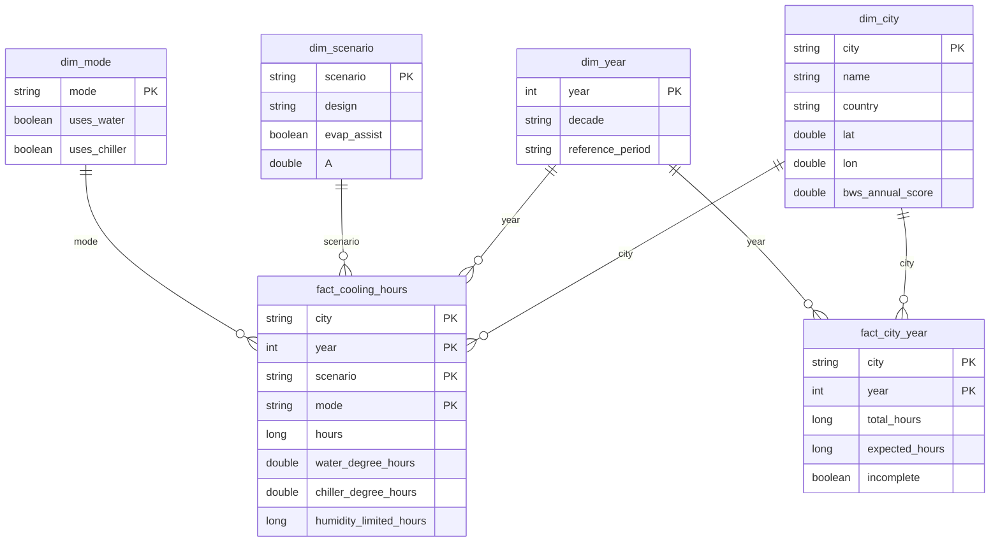

# CoolSite – data model

Purpose, grain and keys of every table. Data flow: [architecture.md](architecture.md). Quality rules: [data_contract.md](data_contract.md).

## 1. Tables

| Table | Layer | Grain (one row =) | Key | Source / stored as |
|---|---|---|---|---|
| bronze | raw | one API response for one city × load window | city + start + end + fetched_at | JSON, `data/bronze/city=<city>/<start>_<end>__fetched_<UTC>.json`, never changed |
| silver | clean | one hour of one city | city + time | Parquet, partitioned by `city`, `year` |
| quarantine | rejected | one rejected hour | city + time (not unique) | Parquet, append-only |
| `fact_cooling_hours` | gold | one city, year, scenario, mode | city + year + scenario + mode | silver → `classify` per scenario |
| `fact_city_year` | gold | one city, year | city + year | silver, hours counted directly |
| `dim_city` | gold | one city | city | `cities_all.csv` + `cities_water_stress.csv` |
| `dim_year` | gold | one calendar year | year | generated from the years in the facts |
| `dim_scenario` | gold | one cooling scenario | scenario | `data/seed/dim_scenario.csv` |
| `dim_mode` | gold | one cooling mode | mode | `data/seed/dim_mode.csv` |

Gold is stored as Parquet, one folder per table in `data/gold/`, and fully recomputed from silver on every run.

## 2. ER diagram (gold)

`||--o{` = one row in the dimension, zero or many rows in the fact.

**Balance rule between the two facts:** every valid hour belongs to exactly one mode per scenario → per city × year × scenario, `SUM(fact_cooling_hours.hours) = fact_city_year.total_hours`.

## 3. Columns

### silver
| Column | Type | Meaning |
|---|---|---|
| city, year | string, int | city slug; calendar year (UTC) – partition columns |
| time | timestamp | start of the hour, UTC |
| temperature_c, humidity_pct, dew_point_c | double, int, double | 2 m air temperature (°C), relative humidity (%), dew point (°C) |
| wet_bulb_c | double | wet-bulb temperature (°C), Stull (2011) |
| source_model, contract_version | string | `era5_land`; data contract version used |
| run_id, processed_at | string, timestamp | lineage: which run wrote the row, and when |

Quarantine has the raw hour plus `failed_rules` (array of rule IDs, e.g. `["DQ-07"]`), `run_id` and `processed_at`.

### fact_cooling_hours
| Column | Type | Meaning |
|---|---|---|
| city, year, scenario, mode | string, int, string, string | keys |
| hours | long | valid hours in this mode |
| water_degree_hours | double | K·h of cooling done with water – proxy for water demand |
| chiller_degree_hours | double | K·h of cooling done by the chiller – proxy for chiller electricity |
| humidity_limited_hours | long | hours in which outside air was too humid to use (direct design) |

All measures are additive. Degree-hours per hour (a = threshold of the scenario):

| mode | water_degree | chiller_degree |
|---|---|---|
| free | 0 | 0 |
| evaporative | T − a | 0 |
| hybrid | T − supply_after_evap | supply_after_evap − a |
| chiller | 0 | max(T − a, 0) |

Limitation: cool but humid hours run the chiller yet add 0 chiller degree-hours → they are counted in `humidity_limited_hours`.

### fact_city_year
| Column | Type | Meaning |
|---|---|---|
| city, year | string, int | keys |
| total_hours | long | valid hours in silver (additive) |
| expected_hours | long | 8,760 or 8,784 (additive) |
| coverage | double | total ÷ expected for this single year – never sum or average it |
| incomplete | boolean | coverage < 99.9 %; filter (e.g. hide the current year in trends) |

Coverage over a selection = `SUM(total_hours) / SUM(expected_hours)`, computed in the dashboard.

### dim_city
Main columns (full list: `data/seed/city_list_all.csv`, `cities_all.csv`):
`city` (key, slug) · `name` · `country` · `region` · `cw_region` · `regulatory_zone` (EU / EEA / non-EU) · `scope` (project / outlook) · `my_group` (FLAP-D / challenger) · `cw2026_tier`, `cw2026_rank` · `lat`, `lon` · `timezone` · `climate_class` (Köppen) · `pfaf_id` (Aqueduct river basin) · `bws_annual_score` (0–5), `bws_annual_cat`, `bws_annual_label` · `bws_months_ge_4` (months with monthly water-stress score ≥ 4).

### dim_year
`year` (key) · `decade` (e.g. `1980s`) · `reference_period` (`before 1961` / `1961–1990` / `1991–2020` / `recent`; WMO reference periods).

### dim_scenario
One row per design + parameter set; values in `data/seed/dim_scenario.csv`. `classify` reads its parameters from this table.
Columns: `scenario` (key) · `sort_order` · `label` · `cooling_type` (`air`) · `design` (`direct` / `indirect`) · `evap_assist` (hybrid mode allowed?) · `A` · `dew_max`, `dew_min` (direct only) · `eps_evap` · `eps_hx`, `T_return` (indirect only) · `description` · `source`.
The threshold of the indirect design, T_return − (T_return − A) / eps_hx ≈ 22.7 °C, is computed in `classify`, not stored.

Parameter sources:
- A = 27 °C, dew point −9 … 15 °C: ASHRAE TC 9.9 recommended envelope.
- eps_evap = 0.8: ASHRAE Handbook – HVAC Systems and Equipment, ch. 41 (rigid-media direct evaporative coolers 70–95 %).
- eps_hx = 0.7: ASHRAE Handbook ch. 41 (indirect 40–80 %); Park & Seo (2018).
- T_return = 37 °C: A + 10 K server ΔT (STULZ: 10–15 K); lower bound, so conservative.

### dim_mode
One row per mode; values in `data/seed/dim_mode.csv`.
Columns: `mode` (key: free / evaporative / hybrid / chiller – must match `classify`) · `label` · `uses_water` · `uses_chiller` · `color` (hex) · `sort_order`.

## 4. Design decisions
- **Star schema with two facts**, because the data has two grains; the four dimensions are shared, so one filter on city or year applies to both facts.
- **Additive measures stored, ratios computed** (mode share, coverage over a selection) in the dashboard.
- **Grain stays yearly.** Silver keeps hourly data, so a monthly fact can be added later without rework. Operators consider water stress at site selection, not by switching modes per season (Google 2023, Equinix 2024).
- **Scenario parameters live in data**, not in code. A new assumption gets a new scenario row; existing rows are only edited to fix mistakes. Tests use their own fixed parameters.
- **Natural keys** (city slug, scenario name, mode name) – simple and readable at this size; surrogate integer keys would suit a larger warehouse.
- **Direct design in Europe: humidity, not heat, switches the chiller on.** With dew_max = 15 °C, 0 hybrid hours in the direct design (23 cities, 1961–2026), so the two direct scenarios agree there. Both are kept for hot, dry outlook cities (e.g. Riyadh), where hybrid hours may occur.
- **Indirect design:** with evaporative assist a pure chiller is never needed; without it, those hours become chiller hours (997 of 1,518 city-years).
- Time stored in UTC; silver is updated by an upsert on city + time ([ADR-002](adr/ADR-002-incremental-loading.md)).

## 5. Open items
- [ ] Zero-hour modes: one row per mode even with 0 hours (needed for charts)
- [ ] Star-schema data tests: unique keys, referential integrity, balance
- [ ] `iso3` in `dim_city` (only needed for country-level data such as Ember)
- [ ] Extensions: scenarios `no_water` (free + chiller only) and `liquid_w40`; threshold slider via a temperature histogram (A only)
